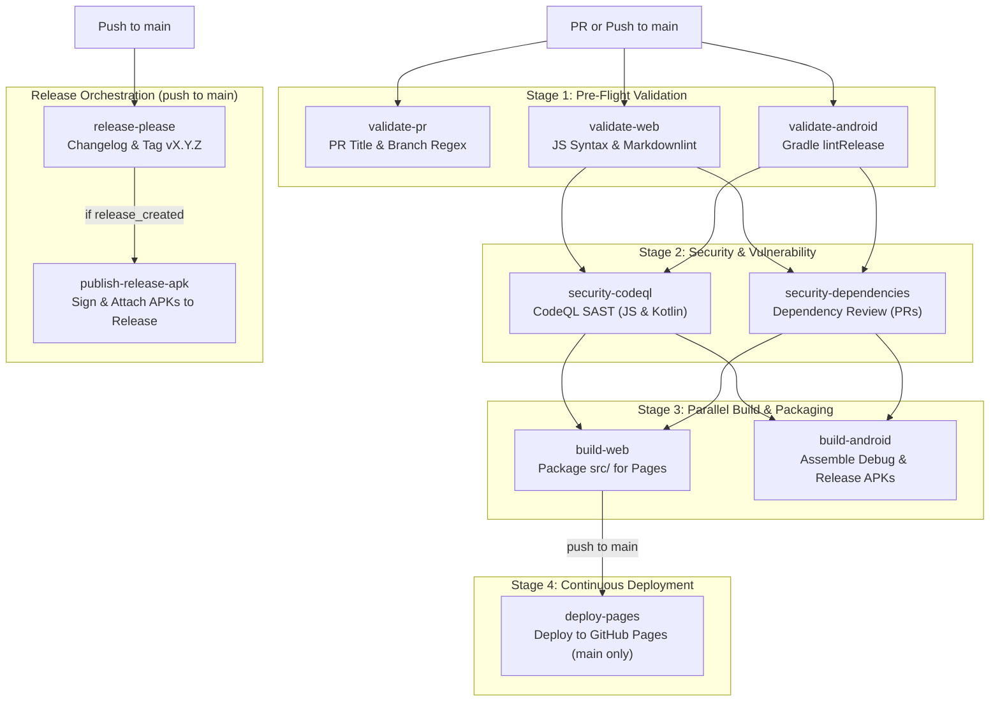

# CI & Release Workflows

Workflows live in [`.github/workflows/`](../.github/workflows). The repository uses a unified two-workflow architecture designed for pre-flight validation, parallel artifact builds, vulnerability scanning, and deterministic release distribution.

---

## 1. CI/CD Pipeline ([`ci.yml`](../.github/workflows/ci.yml))

| Trigger | Condition |
| :--- | :--- |
| **Pull Request** | Targets `main` (`opened`, `synchronize`, `reopened`, `edited`) |
| **Push** | Targets `main` |
| **Manual** | `workflow_dispatch` |

### Stage 1: Pre-Flight Validation
- **`validate-pr`**: Enforces [Conventional Commits](https://www.conventionalcommits.org/) on PR titles and verifies internal branch names match `^(feat|fix|perf|docs|ci|chore|refactor|test|style)/.+`.
- **`validate-web`**: Performs JavaScript syntax verification (`node --check src/js/app.js`) and documentation linting using `markdownlint-cli2`.
- **`validate-android`**: Runs `./gradlew --no-daemon lintRelease` with Gradle caching.

### Stage 2: Security & Vulnerability Scanning
- **`security-codeql`**: Runs CodeQL static analysis in parallel across both `javascript-typescript` and `java-kotlin`, fulfilling the repository's code quality ruleset.
- **`security-dependencies`**: Evaluates dependency vulnerability diffs on pull requests.

### Stage 3: Parallel Build & Packaging
- **`build-web`**: Packages and validates `src/` as a Pages deployment artifact.
- **`build-android`**: Assembles debug and release APKs (`./gradlew --no-daemon assembleDebug assembleRelease`) and uploads them as the `sonic-mandala-android` artifact.

### Stage 4: Continuous Deployment
- **`deploy-pages`**: Deploys the web application to GitHub Pages. Executes **only** on push to `main` after all prior validation and packaging stages pass.

---

## 2. Release Automation ([`release.yml`](../.github/workflows/release.yml))

Automates SemVer releases and asset distribution on pushes to `main`:

1. **Release Please**: Inspects conventional commits, updates the Release PR, and generates the changelog.
2. **Synchronized APK Publishing**: When a release PR is merged (`releases_created == 'true'`):
   - Checks out the newly created tag `vX.Y.Z`.
   - Decodes the release keystore from secrets (`ANDROID_KEYSTORE_BASE64`).
   - Compiles the signed release APK (`./gradlew assembleRelease`).
   - Uploads the signed APK directly to the newly created GitHub Release via `gh release upload`.

### Signing Secrets

| Secret | Purpose |
| :--- | :--- |
| `ANDROID_KEYSTORE_BASE64` | Base64-encoded keystore (`base64 -w0 file`) |
| `KEYSTORE_PASSWORD` | Keystore password |
| `KEY_ALIAS` | Key alias |
| `KEY_PASSWORD` | Key password |
